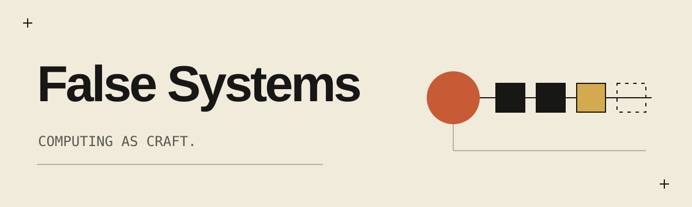
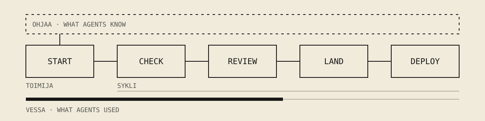

**Delegate more. Move faster. Keep control.**

We build for people and agents working together: work that stays continuous,
authority that stays accountable, and a record worth trusting.
[false-systems.com](https://false-systems.com) ·
[Manifesto](https://false-systems.com/manifesto.html)

## Tools for working with coding agents

Four small command-line tools. Each one works alone. Together they take a change
from an agent's first prompt to production: checked, reviewed by a second agent,
landed and deployed, with no server and no pull request required.

| Tool | What it does |
|---|---|
| [**toimija**](https://github.com/false-systems/toimija) | Starts an agent with the facts of the repository, and shows who is working where. |
| [**sykli**](https://github.com/false-systems/sykli) | Runs the checks you declare and keeps proof. A second agent reviews the change; sykli lands and deploys only what is proven. |
| [**ohjaa**](https://github.com/false-systems/ohjaa) | Holds what your agents are told: decisions, lessons, facts. Anyone can propose; a person decides. |
| [**vessa**](https://github.com/false-systems/vessa) | Counts what your agents used, from the records they leave on disk. Numbers only; never prices. |

They work with Claude Code, Codex, pi and opencode, on macOS and Linux. sykli
and vessa also run on Windows; toimija and ohjaa run there under WSL.

**Start with [Your first loop](https://github.com/false-systems/toimija/blob/main/docs/first-loop.md)**:
one change, through all four tools, in ten minutes.

## What they hold to

- **Independent.** The agent never judges its own change: a different agent
  reviews it, and only a person can overrule a block.
- **Honest.** What could not be read stays unknown. A partial count says it is
  partial; it is never shown as zero.
- **Portable.** Your work, rules and records live in your repositories and on
  your machine, not with an agent vendor or a service of ours.

## Also from False Systems

- [rauta](https://github.com/false-systems/rauta): a Kubernetes API gateway in Rust.
- [false-agent-protocol](https://github.com/false-systems/false-agent-protocol): versioned contracts between the tools.

All of it is MIT licensed.
